<p align="center">
  
</p>

<h1 align="center">HealthyMind FHIR Server</h1>

<p align="center">
  <b>A production-grade FHIR R4 server, terminology server and validator for hospitals, written in Rust.</b><br>
  Built and operated by HealthyMind Tech, based on the open-source
  <a href="https://github.com/HeliosSoftware/hfs">Helios FHIR Server</a>.
</p>

<p align="center">
  
  
  
  
  
</p>

<p align="center">
  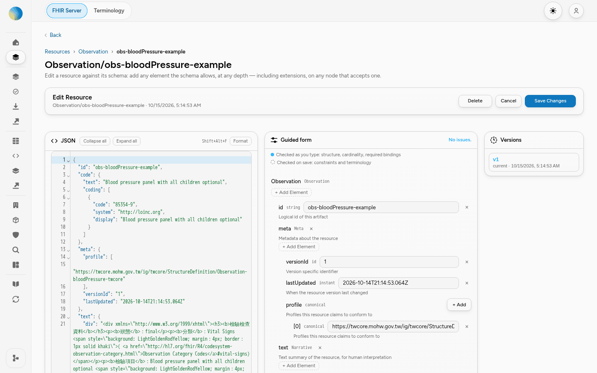
</p>

---

## Contents

- [What it is](#what-it-is)
- [Who it is for](#who-it-is-for)
- [Key capabilities](#key-capabilities)
- [Screenshots](#screenshots)
- [Architecture](#architecture)
- [Quality, measured](#quality-measured)
- [Quick start](#quick-start)
- [Configuration highlights](#configuration-highlights)
- [Deployment and operations](#deployment-and-operations)
- [Roadmap](#roadmap)
- [Support and contact](#support-and-contact)
- [Acknowledgements and license](#acknowledgements-and-license)

## What it is

HealthyMind FHIR Server is a complete FHIR platform for a hospital's
production environment. One deployment gives you three things that usually
come from three different products:

- **A FHIR R4 server (`hfs`)**: REST API, search, transactions, history,
  Bulk Data, Subscriptions, SMART on FHIR authorization and an IHE BALP audit
  trail, on PostgreSQL.
- **A FHIR terminology server (`hts`)**: CodeSystem, ValueSet and ConceptMap
  operations (`$lookup`, `$validate-code`, `$expand`, `$subsumes`,
  `$translate`, `$closure`), with importers for SNOMED CT, LOINC, ICD-10-CM/PCS,
  the Taiwan ICD tables, NDC and more.
- **A FHIR validator**: `$validate` and optional validate-on-write against the
  profiles of the Implementation Guides you install, with terminology checks
  answered by the terminology server.

Both servers come with a web console for browsing, editing, validating,
installing IG packages and managing terminology.

The goal is to **replace HAPI FHIR** in hospital deployments with a single,
memory-efficient Rust service. It is tuned for **Taiwan**: TW Core and the
other Ministry of Health and Welfare (MOHW) / NHI Implementation Guides,
Traditional Chinese (zh-Hant) terminology displays and a fully translated
console. Nothing in it is Taiwan-only; US Core, IPS, mCODE, Da Vinci and other
international IGs run on the same server.

## Who it is for

- **Hospitals and health systems** that need a FHIR server for national
  exchange (TW Core, EMR exchange, NHI pre-authorization, e-prescription,
  reportable disease) or for internal integration.
- **Health-IT vendors and integrators** that want a FHIR backend with
  validation and terminology included, rather than three separate products.
- **Teams running HAPI FHIR today** that want lower memory use, a built-in
  terminology server and an operations story (backups, PITR, monitoring,
  upgrades) written down and rehearsed.

## Key capabilities

| Area | What you get |
|---|---|
| **FHIR REST** | R4 (4.0.1) create / read / vread / update / patch / delete, history, batch and transaction Bundles, conditional operations, `$meta`, JSON and XML with correct FHIR media types, multi-tenancy. |
| **Search** | Spec search parameters plus those from installed IGs; chains, `_has`, `_include` / `_revinclude`, `_sort`, `_summary`, `_elements`, token modifiers including `:in`, `:not-in` and `:below` answered by the terminology server. Indexes reviewed on 2.6M resources (see [index strategy](docs/ops/index-strategy.md)). |
| **Validation** | `$validate` against core FHIR and installed IG profiles: slicing, extensions, invariants (FHIRPath), reference targets, Bundle rules, required / extensible bindings. Terminology can be checked by the remote terminology server (`HFS_VALIDATION_TERMINOLOGY=remote`). Validate-on-write in three modes: `off`, `log`, `enforce`. |
| **Terminology server** | Full HL7 tx-ecosystem conformance (see [numbers](#quality-measured)), full ECL 2 and SNOMED CT post-coordinated expressions, implicit ValueSets, CodeSystem supplements, versioned canonicals, `displayLanguage` (for example zh-Hant), expansion caching. |
| **Terminology importers** | SNOMED CT RF2, LOINC (with parts, answer lists, linguistic variants), ICD-10-CM, ICD-10-PCS, ICD-9-CM, Taiwan NHI ICD-10-CM/PCS (zh-Hant), RxNorm RRF, FDA NDC, NUCC, MeSH, NCI Thesaurus, UCUM, DICOM, HL7 v2 tables, and any FHIR CodeSystem/ValueSet Bundle or IG package. |
| **IG package manager** | Browse packages.fhir.org from the console, upload `.tgz`, resolve dependencies, dry-run, install, upgrade, side-by-side major versions, uninstall. Conformance resources go to the FHIR server, terminology to the terminology server. |
| **SMART on FHIR / OIDC** | JWT bearer validation against your IdP (tested with Keycloak), SMART v1 and v2 granular scopes, patient-compartment enforcement, backend services with `private_key_jwt`, per-client rate limits. `HFS_AUTH_MODE=write-protect` (anonymous read, authenticated write) or `full`. See [auth.md](docs/ops/auth.md). |
| **Audit trail** | Every REST interaction recorded as an IHE BALP `AuditEvent`, searchable through `/AuditEvent`, immutable through the API, queued writes that never drop events, retention with an archive written before each purge. The terminology server writes into the same trail. See [audit.md](docs/ops/audit.md). |
| **Bulk Data** | `$export` (system, Patient, Group, `_typeFilter`) and `$bulk-submit` ingestion. Patient/`$everything`. Tested with 3.1M Synthea resources (see [numbers](#quality-measured)). |
| **Clinical quality (CQL)** | Works as the data source and terminology source for an external CQL engine: eCQM retrieves with `code:in`, expansion-only VSAC ValueSets, Measure evaluation through the engine. See [cql.md](docs/ops/cql.md). |
| **Cluster** | Several HFS and HTS instances on one PostgreSQL: shared job queues, Subscription delivery, profile and SearchParameter propagation, terminology cache invalidation, admin sessions in the database. Rolling restarts tested without failed requests. See [cluster.md](docs/ops/cluster.md). |
| **PostgreSQL in production** | Versioned schema migrations, pool and timeout settings, a non-superuser runtime role, logical dumps, WAL archiving and point-in-time recovery with rehearsed restore times, Prometheus metrics and OTLP traces. See [docs/ops](docs/ops/README.md). |
| **Web console** | `/ui` (FHIR) and `/ui/hts` (terminology): dashboards, resource browser with a query builder, schema-driven resource editor, validator, capability statement, IG packages, terminology inventory and import jobs, light and dark themes, mobile layout, English / 繁體中文 / Deutsch / Español. Admin pages need administrator sign-in. |
| **Also included** | FHIRPath engine (CLI and HTTP), SQL on FHIR (ViewDefinitions, CLI, HTTP, Python bindings), topic-based Subscriptions, CDS Hooks types; inherited from the upstream project. |

## Screenshots

All screenshots are from our reference deployment, which holds test data only.
The console still shows the upstream "Helios" product name in a few places.

| | |
|---|---|
| 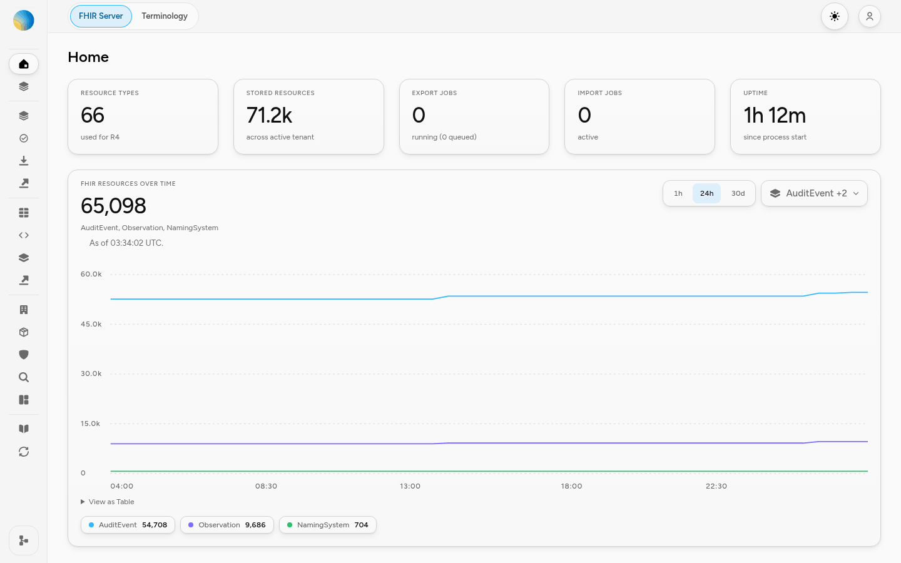 | 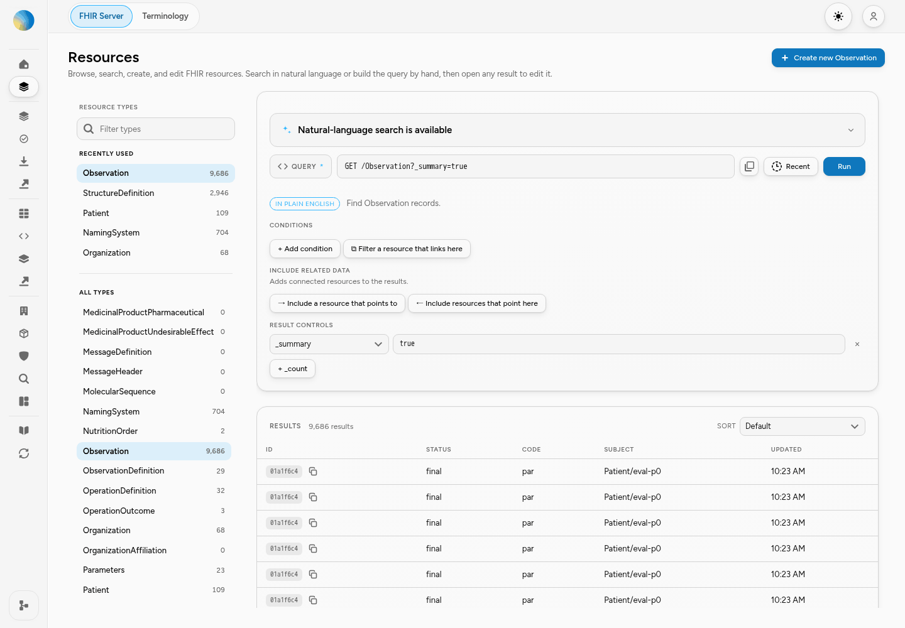 |
| **FHIR console**: resource counts, jobs, uptime and growth over time. | **Resource browser**: pick a type, build a query by hand or in plain language, open any result. |
| 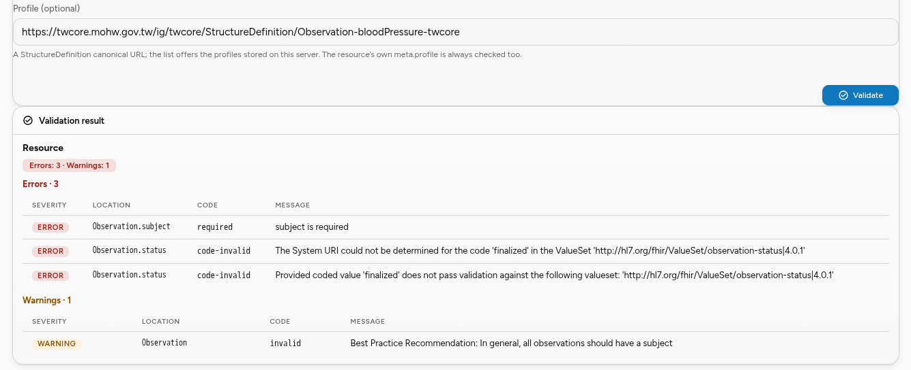 | 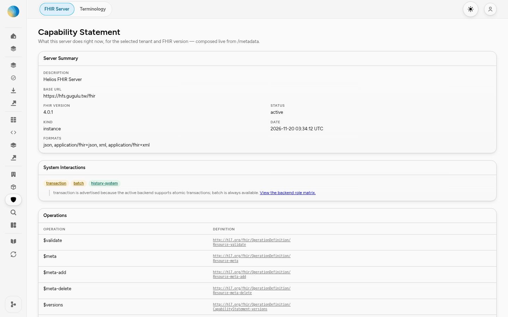 |
| **`$validate`**: a broken TW Core blood-pressure Observation, with errors located by path. | **Capability statement**, composed live from `/metadata`. |
| 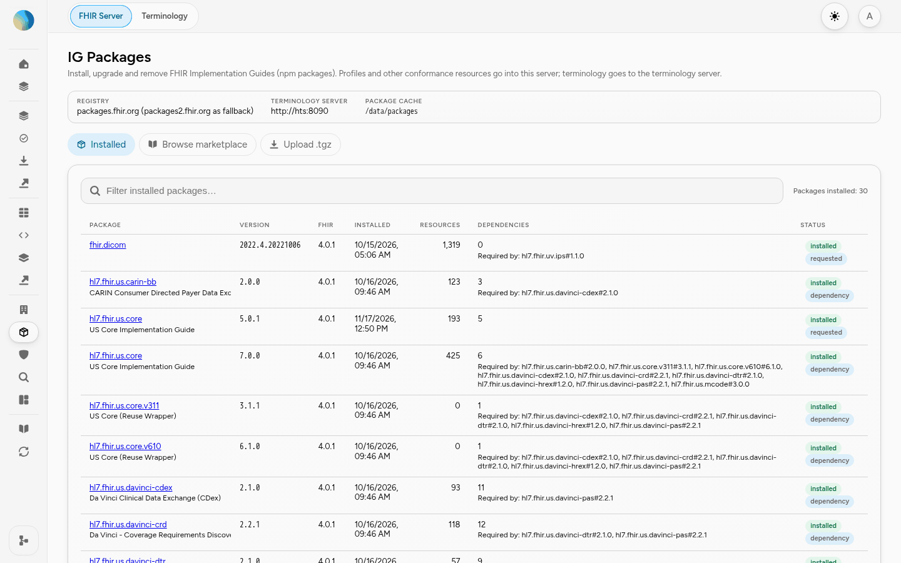 | 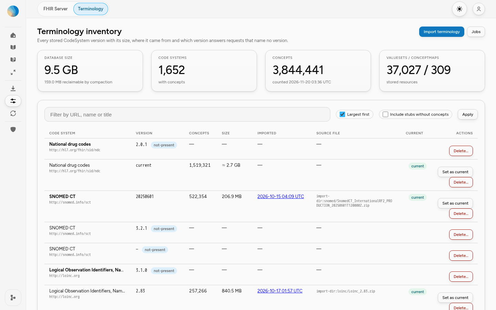 |
| **IG package manager**: installed packages with their dependency graph; browse the registry or upload a `.tgz`. | **Terminology inventory**: 3.8M concepts in 9.5 GB, by code system and version. |
| 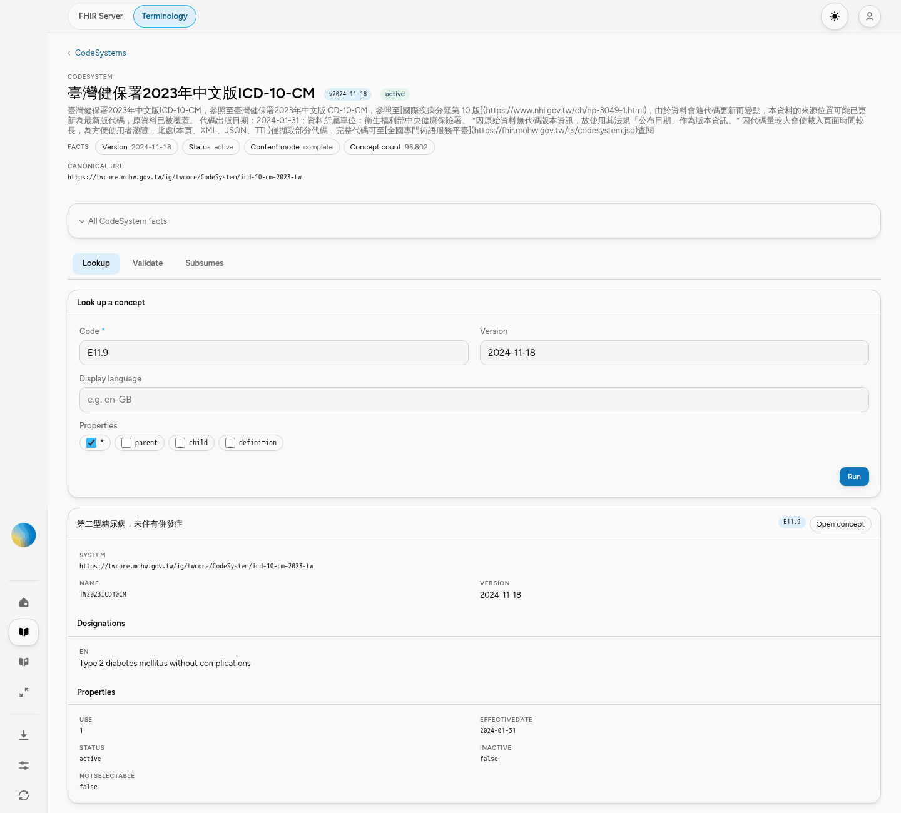 | 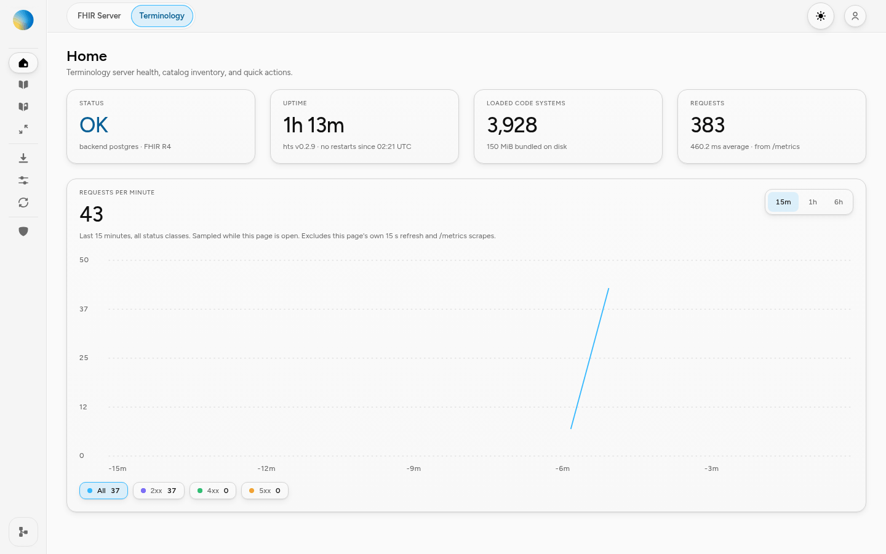 |
| **`$lookup`** in the Taiwan NHI ICD-10-CM (zh-Hant): E11.9 with its Chinese display and English designation. | **Terminology console**: health, catalog size and traffic. |
| 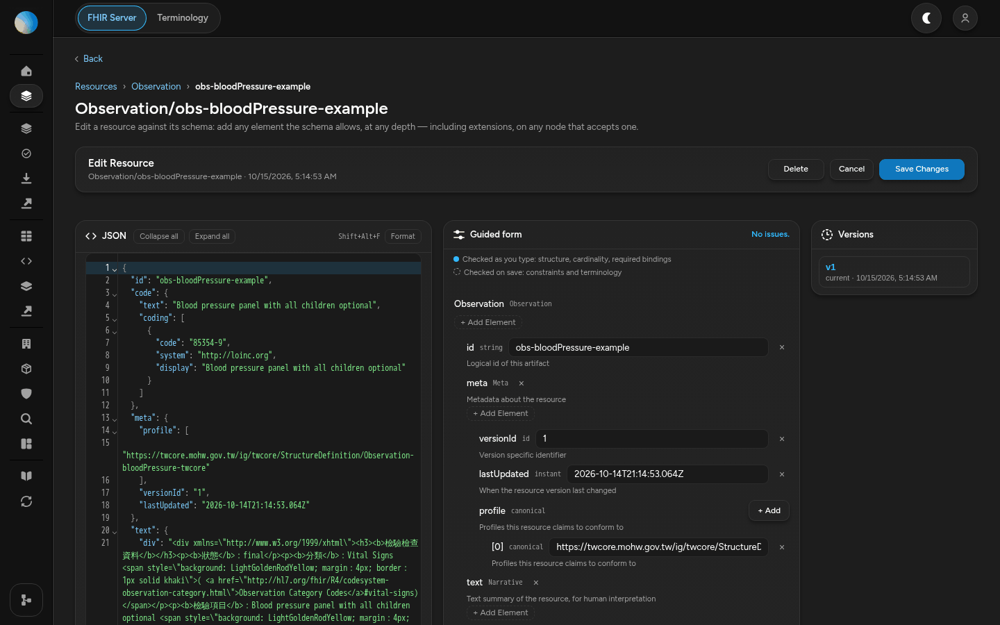 | 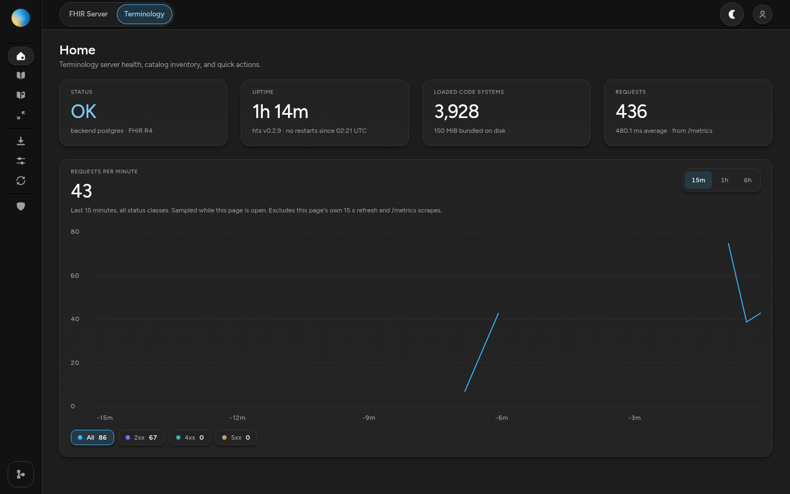 |
| **Dark mode** (follows the system, or set per browser). | |

<p align="center">
  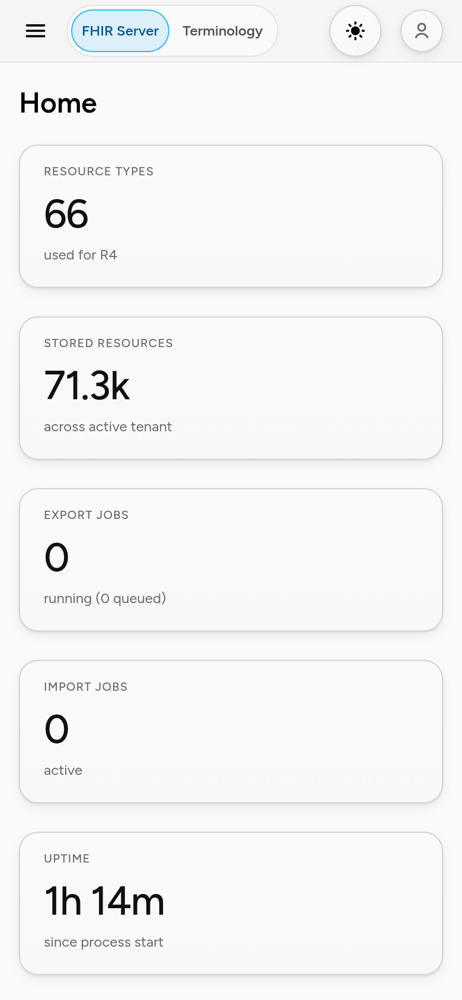
  &nbsp;&nbsp;
  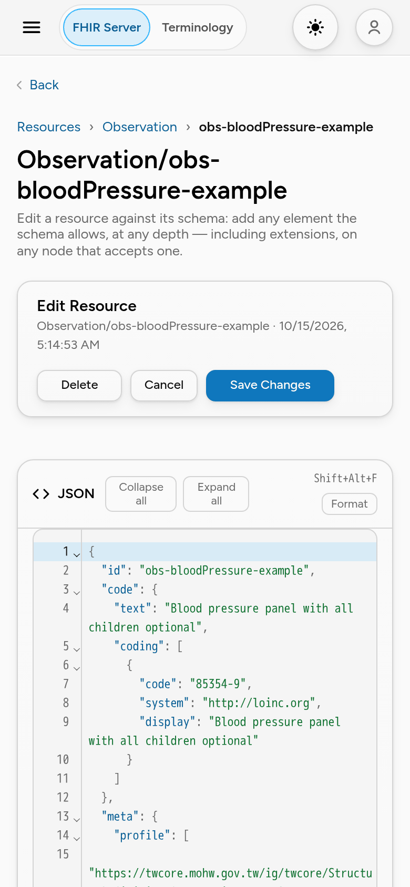
  <br><b>Phone layout</b>: the console works at mobile widths.
</p>

## Architecture

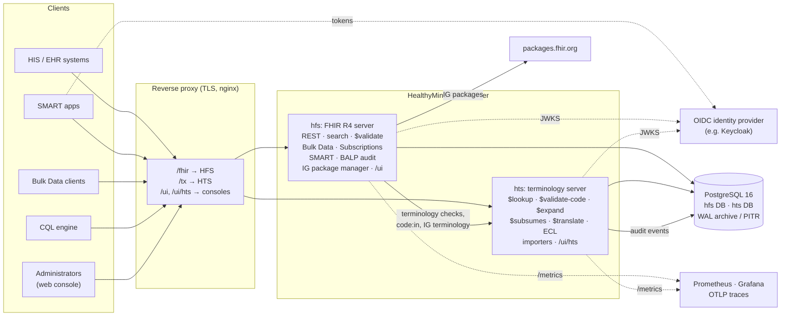

- **One PostgreSQL**, two databases. SQLite is supported for development and
  tests only.
- **HFS asks HTS** for every terminology question: binding checks during
  validation, `code:in` searches and the terminology part of IG packages.
- **Horizontal scale**: run 2–3 HFS and 2 HTS instances behind the proxy with
  `HFS_CLUSTER=true` ([cluster.md](docs/ops/cluster.md)).

## Quality, measured

Every number below names its test suite and what it counts. Where a target was
missed, we say so. Full reports are kept with the project's evaluation records.

### Terminology server: HL7 tx-ecosystem test suite

Official HL7 `fhir-tx-ecosystem-ig` tests, run with the HL7 `validator_cli`
test runner, on PostgreSQL and SQLite (identical results):

| Suite | Result |
|---|---|
| General | **697 / 697** |
| SNOMED CT | 72 / 72 |
| SNOMED CT ECL | 103 / 103 |
| UCUM | 19 / 19 (1 skipped) |
| closure | 10 / 10 |
| mimetypes | 39 / 39 |
| Runner total | **872 / 872** (5 skipped) |

Suites that need data we do not hold (OMOP, ICD-11) and tx.fhir.org-only
suites were not run.

### Validator: HL7 `fhir-test-cases` (R4-applicable, 457 sub-tests)

The four classes of the old harness are split so that a "deviation" with the
wrong verdict counts as a failure:

| Class | Count |
|---|---|
| Strict pass (same error count and locations) | 325 |
| Pass on error count only (locations differ) | 55 |
| Deviation, right verdict, different count | 22 |
| **Deviation, wrong verdict (real failure)** | **32** (23 missed errors, 9 false positives) |
| Data unavailable (licensed or unavailable content: SNOMED national editions, HCPCS, X12, EDQM, NUCC, HGVS, VSAC) | 23 |

Reported the old way this is 380 pass / 54 deviation / 23 data-unavailable.
The 23 missed errors are features not implemented yet: terminology authoring
rules, R5 xhtml controls, Bundle signatures, `htmlChecks()` and a few smaller
rules.

### Validator: difference test against the HL7 Java validator

The same IG examples validated by our server and by the HL7 Java validator
(with tx.fhir.org). Set 9 = 590 examples (Taiwan IGs, US Core, IPS); set new =
729 examples from the other installed packages.

| Set | Agree on "has an error" | Precision | Recall | Same, excluding Java-side / licensed-terminology differences |
|---|---|---|---|---|
| 9 | 94.4 % | 98.1 % | 82.6 % | 100 % / 100 % / 96.5 % |
| new | 91.1 % | 89.2 % | 68.7 % | 98.5 % / 92.2 % / 86.9 % |

Precision = matched errors / errors we report; recall = matched errors / errors
the Java validator reports. Our targets were ≥ 97 % agreement and ≥ 85 %
recall on the raw numbers; **those raw targets are not met yet**. Most of the
gap is content we cannot load (SNOMED CT US Edition, CPT/HCPCS/X12, the HGVS
service), which is why the right-hand column is shown separately.

In `enforce` mode, 1,503 published examples from 37 packages (including all
seven Taiwan IGs) produced 143 rejections; every one was traced to the example
itself, a missing dependency, a version mismatch or a deliberate stricter
rule; **0 were validator bugs**. TW Core 1.0.0 and TW PAS examples: 0
rejections.

### Scale and performance (PostgreSQL on NVMe)

| Measurement | Result |
|---|---|
| 23 common search shapes on 2.64M resources (warm) | patient-scoped searches p95 4–21 ms; slowest shapes (code + date across all patients, chains over 2,000 targets, `$everything`) p95 119–224 ms |
| Load, Synthea transaction Bundles, 16 clients | 3.17M resources at 4,406 resources/s, 0 failed Bundles |
| Group `$export`, 14,000 patients (3.1M resources) | 243 s |
| `Patient/$everything`, 50 patients | p50 125 ms / p95 235 ms, complete, no duplicates |
| Restore drill (production-sized dump) | RTO about 1.5 min logical, about 1 min PITR; RPO ≤ 5 min with WAL archiving |
| Cluster: 3 HFS + 2 HTS, rolling restarts under load | 57 / 57 checks, 0 failed requests |
| CQL: 15 eCQMs, 273 test patients | 264 / 273 patients agree with the engine's reference run (HAPI FHIR 8.12 on the same data: 242 / 273) |

Rotating disks are not supported for the database: on an HDD, loads failed
with statement timeouts once the database passed about 9 GB.

### Test suites

At the current `hm/main`: Rust workspace (default features) **10,666 passed,
0 failed**; PostgreSQL persistence suite 3,821 / 0; terminology server on
PostgreSQL 2,000 / 0; `--all-features` (the CI selection) 12,127 / 0. Each
production deployment is gated by a 94-case validator regression (94 / 94),
112 terminology API checks, 184 FHIR API checks and 42 authentication checks
against the public URL.

## Quick start

### Run locally from source (SQLite, for evaluation)

Requires [Rust](https://www.rust-lang.org/tools/install) (1.95 or newer; the
toolchain is pinned in `rust-toolchain.toml`) and, on Linux, `clang` + `lld`
(see [Building from source](#building-from-source)).

```bash
git clone https://github.com/healthymind-tech/hfs.git
cd hfs
cargo build --release --locked -p helios-hfs -p helios-hts

# 1. Terminology server on :8090, seeded with the bundled terminology set
HTS_BOOTSTRAP_DIR=./crates/hts/terminology-data ./target/release/hts &

# 2. FHIR server on :8080, wired to the terminology server, console enabled
HFS_TERMINOLOGY_SERVER=http://127.0.0.1:8090 \
HFS_ADMIN_UI=true HFS_ADMIN_PASSWORD="$(openssl rand -base64 24)" \
./target/release/hfs
```

Then open:

| URL | What |
|---|---|
| http://localhost:8080/ui | FHIR console |
| http://localhost:8080/metadata | CapabilityStatement |
| http://localhost:8090/ui/hts | Terminology console |
| http://localhost:8090/metadata | Terminology server CapabilityStatement |

```bash
# Create and search a resource
curl -s -X POST http://localhost:8080/Patient \
  -H 'Content-Type: application/fhir+json' \
  -d '{"resourceType":"Patient","name":[{"family":"Chen","given":["Ming"]}]}'
curl -s 'http://localhost:8080/Patient?family=Chen'

# Validate without storing
curl -s -X POST http://localhost:8080/Patient/\$validate \
  -H 'Content-Type: application/fhir+json' \
  -d '{"resourceType":"Patient","gender":"unknown-value"}'
```

### Production: Docker Compose with PostgreSQL

`docker/production/` contains the production stack: PostgreSQL 16 with WAL
archiving, HTS, HFS, nginx, and an optional monitoring profile (Prometheus,
Grafana, postgres-exporter, OTLP collector, Jaeger).

```bash
cd docker/production
cp .env.example .env && chmod 600 .env && $EDITOR .env   # image tags, secrets, public URL, storage paths
docker compose up -d db
docker compose up -d hts        # first boot imports the bundled terminology (~4 min)
docker compose up -d hfs nginx
curl -s -o /dev/null -w '%{http_code}\n' http://127.0.0.1:8082/fhir/metadata   # 200
```

Images are built from this repository (release binaries with the production
feature set, packaged by the root `Dockerfile`) and pinned by tag; never deploy
`:latest`. The full procedure, sizing and TLS setup are in
[deployment.md](docs/ops/deployment.md); after first start, import SNOMED CT /
LOINC / ICD-10 ([terminology-updates.md](docs/ops/terminology-updates.md)),
install your IGs ([ig-update-sop.md](docs/ops/ig-update-sop.md)) and go
through the [go-live checklist](docs/ops/go-live-checklist.md).
Kubernetes manifests are in `docker/kubernetes/`.

### Building from source

1. Install Rust: `curl --proto '=https' --tlsv1.2 -sSf https://sh.rustup.rs | sh`
2. Linux: `sudo apt install clang lld`, then in `~/.cargo/config.toml`:
   ```toml
   [target.x86_64-unknown-linux-gnu]
   linker = "clang"
   rustflags = ["-C", "link-arg=-fuse-ld=lld", "-C", "link-arg=-Wl,-zstack-size=8388608"]
   ```
   macOS needs no extra linker; on Windows use `lld-link.exe` with
   `rustflags = ["-C", "link-arg=/STACK:8388608"]`.
3. Build with the production feature set:
   ```bash
   cargo build --release --locked -p helios-hfs -p helios-hts --features \
     helios-hfs/R4,helios-hfs/sqlite,helios-hfs/postgres,helios-hfs/ui,helios-hfs/xml,helios-hfs/subscriptions,helios-hfs/bulk-submit-jwe,helios-hfs/mimalloc,helios-hfs/otel,helios-hts/postgres,helios-hts/otel
   ```
   If the build runs out of memory, limit parallel jobs: `export CARGO_BUILD_JOBS=4`.
4. Run the tests: `cargo test --workspace` (add `--all-features` for the CI
   selection; PostgreSQL integration tests use Docker testcontainers).

## Configuration highlights

Both servers are configured with environment variables. The most important
ones for a hospital deployment:

| Variable | Typical value | Purpose |
|---|---|---|
| `HFS_STORAGE_BACKEND` / `HFS_DATABASE_URL` | `postgres` / `postgres://hfs:…@db:5432/hfs` | FHIR data store |
| `HTS_STORAGE_BACKEND` / `HTS_DATABASE_URL` | `postgres` / `postgresql://hts:…@db:5432/hts` | Terminology store |
| `HFS_BASE_URL` | `https://fhir.hospital.example/fhir` | Public base URL written into Bundle links |
| `HFS_TERMINOLOGY_SERVER` | `http://hts:8090` | Terminology server used by HFS |
| `HFS_TERMINOLOGY_SERVER_TOKEN` | HTS admin credential | Lets the package manager write IG terminology to HTS |
| `HFS_VALIDATION_MODE` | `off` → `log` → `enforce` | Validate on write; start with `log` and review |
| `HFS_VALIDATION_TERMINOLOGY` | `remote` | Answer binding checks with HTS |
| `HFS_ADMIN_UI` / `HFS_ADMIN_PASSWORD(_FILE)` | `true` / secret | Console admin pages (fail closed without a password); same for `HTS_*` |
| `HFS_AUTH_MODE` | `write-protect` or `full` | SMART on FHIR / OIDC enforcement |
| `HFS_AUTH_ISSUER` / `HFS_AUTH_JWKS_URL` / `HFS_AUTH_AUDIENCE` | your IdP | Token validation; `HTS_AUTH_*` for the terminology server |
| `HFS_RATE_LIMIT_ANONYMOUS` / `HFS_RATE_LIMIT_AUTHENTICATED` | `600` / `6000` per minute | Per-client rate limits |
| `HFS_AUDIT_BACKEND` | `database` | IHE BALP audit trail |
| `HFS_AUDIT_RETENTION_DAYS` | e.g. `2557` (7 years) | Audit retention, with archive before purge |
| `HFS_PG_MAX_CONNECTIONS` / `HFS_PG_STATEMENT_TIMEOUT_MS` | `64` / `60000` | Pool and statement timeout |
| `HFS_BULK_EXPORT_BATCH_SIZE` | `5000` | Bulk export throughput |
| `HFS_CLUSTER` | `true` | Several HFS instances on one database |
| `OTEL_EXPORTER_OTLP_ENDPOINT` | `http://otel-collector:4317` | Traces (image built with `otel`) |

Detailed references: [postgresql.md](docs/ops/postgresql.md),
[auth.md](docs/ops/auth.md), [audit.md](docs/ops/audit.md),
[admin-sign-in.md](docs/ops/admin-sign-in.md),
[cluster.md](docs/ops/cluster.md), [monitoring.md](docs/ops/monitoring.md).
The upstream documentation book in `book/` covers the remaining variables.

## Deployment and operations

The [operations manual](docs/ops/README.md) is written for hospital IT and has
been rehearsed on production-sized data:

| Page | For |
|---|---|
| [go-live-checklist.md](docs/ops/go-live-checklist.md) | everything that must be true before cut-over |
| [deployment.md](docs/ops/deployment.md) | Docker Compose and Kubernetes, sizing, TLS |
| [postgresql.md](docs/ops/postgresql.md) | server parameters, pools, timeouts, roles, maintenance |
| [database-migrations.md](docs/ops/database-migrations.md) | schema versions and how migrations are applied |
| [backup-restore.md](docs/ops/backup-restore.md) | logical dumps, WAL archiving, PITR, drill timings, RPO/RTO |
| [monitoring.md](docs/ops/monitoring.md) | Prometheus, Grafana, alerts, OTLP traces, alert runbook |
| [upgrade.md](docs/ops/upgrade.md) | image upgrades, verification, rollback |
| [index-strategy.md](docs/ops/index-strategy.md) | search index review and EXPLAIN results |
| [auth.md](docs/ops/auth.md) / [admin-sign-in.md](docs/ops/admin-sign-in.md) | SMART on FHIR / OIDC rollout, administrator sign-in |
| [audit.md](docs/ops/audit.md) | audit trail, retention, archive |
| [cluster.md](docs/ops/cluster.md) | multi-instance topology and rolling restarts |
| [cql.md](docs/ops/cql.md) | connecting a CQL engine |
| [ig-packages.md](docs/ops/ig-packages.md) / [ig-update-sop.md](docs/ops/ig-update-sop.md) | the package installer and the IG change procedure |
| [terminology-updates.md](docs/ops/terminology-updates.md) / [terminology-release-calendar.md](docs/ops/terminology-release-calendar.md) | terminology imports and the yearly update calendar |
| [upstream-rebase.md](docs/ops/upstream-rebase.md) | bringing in upstream Helios releases |

Operational scripts (backup, restore, base backup, PITR restore, WAL pruning,
search benchmark, ValueSet warm-up) are in `scripts/ops/`.

## Roadmap

- **FHIR servers manager** *(in development)*: run several FHIR endpoints from
  one installation, each under its own base path and configured from the web
  console; per-endpoint authentication (none or SMART on FHIR); sync and
  duplicate between endpoints; console sign-in with no login, OIDC or
  site-wide username and password.
- **Validator**: Bundle signature verification, HL7-namespace URI resolution,
  `htmlChecks()`, faster stored document Bundles under `enforce`, and higher
  recall against the HL7 Java validator.
- **Upstream**: continue merging Helios FHIR Server releases (currently
  merged through v0.2.9).

## Support and contact

HealthyMind FHIR Server is developed and supported by **療心智能
HealthyMind.Tech**. For deployment, support or partnership enquiries, contact
HealthyMind Tech through the
[healthymind-tech GitHub organization](https://github.com/healthymind-tech).
Bug reports and feature requests are welcome as
[GitHub issues](https://github.com/healthymind-tech/hfs/issues).

Please do not post patient data, credentials or other confidential
information in issues.

## Acknowledgements and license

HealthyMind FHIR Server is a fork of, and is built on, the open-source
**[Helios FHIR Server](https://github.com/HeliosSoftware/hfs)** by
**Helios Software**, released under the MIT License. The FHIR data models,
FHIRPath engine, SQL on FHIR, persistence layer, REST layer, terminology
server foundations and much more come from that project and its contributors;
we are grateful for their work. HealthyMind Tech's changes are focused on
hospital production use: validation and terminology completeness, Taiwan IG
support, SMART on FHIR enforcement, audit, PostgreSQL operations, clustering,
Bulk Data performance and the console. We contribute fixes upstream where they
apply.

HealthyMind FHIR Server is an independent product of HealthyMind Tech. It is
not affiliated with or endorsed by Helios Software. "Helios" and related names
and logos belong to their respective owners.

This project is distributed under the **MIT License**; see
[LICENSE.md](LICENSE.md). The original copyright notice
("Copyright 2025-2026 Helios Software") and permission notice are retained, as
the license requires. Upstream contribution guidelines are in
[CONTRIBUTING.md](CONTRIBUTING.md).

Third-party terminologies are licensed separately. The bundled seed set in
`crates/hts/terminology-data` contains only freely distributable content (HL7
terminology and core packages, ICD-10-CM, ICD-9-CM, NDC, NUCC, MeSH, NCI
Thesaurus, UCUM; see its README). SNOMED CT, LOINC and the Taiwan MOHW/NHI
code tables are **not** distributed with this software; obtain them from their
publishers under their own terms (for example, SNOMED CT requires an Affiliate
Licence or national membership).

FHIR® is the registered trademark of Health Level Seven International (HL7);
its use here does not constitute endorsement by HL7.
