<p align="center">
  
</p>

<h1 align="center">HealthyMind FHIR Server</h1>

<p align="center">
  <b>FHIR Server Manager: a production-grade FHIR R4 server, terminology server, validator and SMART authorization server for hospitals, written in Rust.</b><br>
  Built and operated by HealthyMind Tech, based on the open-source
  <a href="https://github.com/HeliosSoftware/hfs">Helios FHIR Server</a>.
</p>

<p align="center">
  
  
  
  
  
  
</p>

<p align="center">
  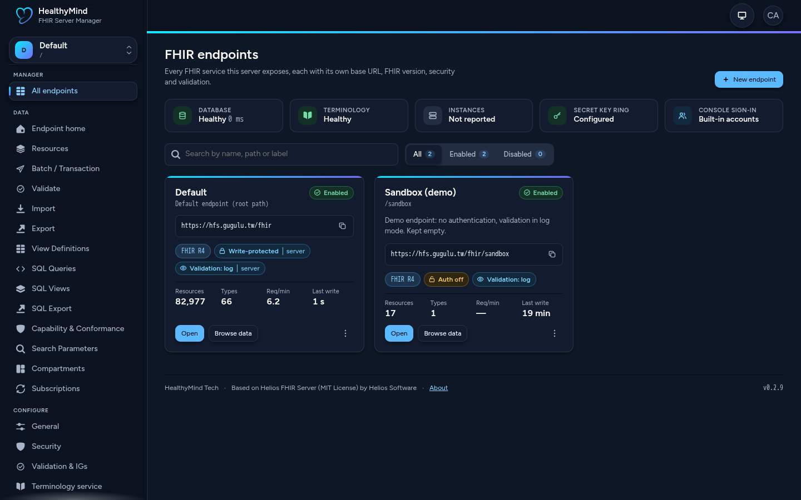
</p>

---

## Contents

- [What it is](#what-it-is)
- [Who it is for](#who-it-is-for)
- [FHIR Server Manager](#fhir-server-manager)
- [One console for FHIR and terminology](#one-console-for-fhir-and-terminology)
- [Built-in authorization server](#built-in-authorization-server)
- [FHIR, validation and terminology capabilities](#fhir-validation-and-terminology-capabilities)
- [Screenshots](#screenshots)
- [Architecture](#architecture)
- [Quality, measured](#quality-measured)
- [Quick start](#quick-start)
- [Configuration quick reference](#configuration-quick-reference)
- [Deployment and operations](#deployment-and-operations)
- [Roadmap](#roadmap)
- [Support and contact](#support-and-contact)
- [Acknowledgements and license](#acknowledgements-and-license)

## What it is

HealthyMind FHIR Server is a complete FHIR platform for a hospital's
production environment. One `hfs` deployment gives you what usually comes
from several products:

- **A FHIR R4 server**: REST API, search, transactions, history, Bulk Data,
  Subscriptions, SMART on FHIR authorization and an IHE BALP audit trail, on
  PostgreSQL.
- **A FHIR Server Manager**: several FHIR endpoints from one installation,
  each at its own base path with its own security, validation, terminology,
  CORS and rate limits, plus sync and duplication between endpoints and
  external FHIR servers, all configured from the web console.
- **A terminology server**: CodeSystem, ValueSet and ConceptMap operations
  (`$lookup`, `$validate-code`, `$expand`, `$subsumes`, `$translate`,
  `$closure`) with importers for SNOMED CT, LOINC, ICD-10-CM/PCS, the Taiwan
  ICD tables, UCUM, NDC and more. It runs **inside `hfs`** (embedded, served
  at `/tx`) or as the separate `hts` service.
- **A FHIR validator**: `$validate` and validate-on-write against the profiles
  of the Implementation Guides you install, with terminology checks answered
  by the terminology server.
- **An OAuth 2 / OpenID Connect / SMART on FHIR authorization server**
  (optional, off by default), so an endpoint can issue its own tokens instead
  of relying on an external identity provider.

Everything is administered from **one web console** with one sign-in.

The goal is to **replace HAPI FHIR** in hospital deployments with a single,
memory-efficient Rust service. It is tuned for **Taiwan**: TW Core and the
other Ministry of Health and Welfare (MOHW) / NHI Implementation Guides,
Traditional Chinese (zh-Hant) terminology displays and a fully translated
console. Nothing in it is Taiwan-only; US Core, IPS, mCODE, Da Vinci and other
international IGs run on the same server.

## Who it is for

- **Hospitals and health systems** that need a FHIR server for national
  exchange (TW Core, EMR exchange, NHI pre-authorization, e-prescription,
  reportable disease) or for internal integration, often several of them side
  by side: production, a sandbox for a vendor, a TW Core test endpoint.
- **Health-IT vendors and integrators** that want a FHIR backend with
  validation, terminology and authorization included, rather than separate
  products.
- **Teams running HAPI FHIR today** that want lower memory use, a built-in
  terminology server and an operations story (backups, PITR, monitoring,
  upgrades) written down and rehearsed.

## FHIR Server Manager

Switched on with `HFS_MANAGER=on`. With it off, the server behaves exactly as
a single FHIR endpoint. Guide: [docs/ops/endpoints.md](docs/ops/endpoints.md);
design: [docs/design/fhir-server-manager.md](docs/design/fhir-server-manager.md).

### Many FHIR endpoints, one installation

- Each endpoint has a **name and a base path**: an endpoint with path
  `twcore` is served at `{HFS_BASE_URL}/twcore`, for example
  `https://fhir.hospital.example/fhir/twcore/Patient/1`. The default endpoint
  keeps the root, so existing clients keep working.
- Each endpoint serves **exactly one tenant** ("one door per tenant"): a
  request or token naming another tenant is refused.
- Every URL the server generates (`Location`, Bundle links, `fullUrl`,
  history, Bulk Data status and manifest URLs, Subscription notifications,
  `CapabilityStatement.implementation.url`) carries the endpoint's prefix.
- Endpoints are created from the console with a **five-step wizard** (basics,
  data, security, validation, review), through the admin REST API
  (`/admin/endpoints`, OpenAPI in
  [docs/api/admin-endpoints.yaml](docs/api/admin-endpoints.yaml)), or declared
  in a file (`HFS_ENDPOINTS_FILE`). A new endpoint can start empty, adopt an
  existing tenant, or duplicate another endpoint.
- Endpoints can be **enabled and disabled** (a disabled endpoint answers
  `503` with an OperationOutcome) and are applied **without a restart**:
  every instance picks up a change within about a second.
- Up to 200 endpoints, with per-endpoint Prometheus metrics
  (`hfs_endpoint_requests_total`, `hfs_endpoint_request_duration_seconds`).

### Per-endpoint settings, inherited by default

Every policy section either **inherits** the server-wide setting (the
environment variable) or is set for that endpoint only. The console shows the
inherited value and which variable it came from.

| Section | Per endpoint | Inherited from |
|---|---|---|
| **Authentication** | `off`, `write-protect` (anonymous read, authenticated write) or `full` SMART on FHIR; issuer, JWKS URL, audience, allowed scope families (patient / user / system), SMART v1 scopes accepted or not; or a realm of the built-in authorization server | `HFS_AUTH_*` |
| **SMART discovery** | `/.well-known/smart-configuration` and `CapabilityStatement.rest.security` generated per endpoint (404 when auth is off) | |
| **Rate limits** | per-client budgets, keyed by endpoint and client | `HFS_RATE_LIMIT_*` |
| **Validation** | write mode `off` / `log` / `enforce`, terminology mode, stored profiles, `requiredProfiles` validated on every write of a type | `HFS_VALIDATION_*` |
| **Terminology** | the terminology server used for `:in` / `:not-in` / `:above` / `:below` searches and binding checks | `HFS_TERMINOLOGY_*` |
| **CORS** | origins, credentials, extra headers (console and admin paths always use the global settings) | `HFS_CORS_*` |
| **FHIR version** | default version, CapabilityStatement `fhirVersion`, resource-type gate | `HFS_DEFAULT_FHIR_VERSION` |
| **IG packages** | packages installed into the endpoint's tenant | |

Secrets typed in the console (OIDC client secrets, terminology tokens, sync
credentials) are **write-only** and stored sealed with AES-256-GCM under the
key ring in `HFS_SECRET_KEYS`; the API answers `{"set": true}`, never the
value. URLs typed in the console pass an **outbound (SSRF) policy**: public
`https` only, unless listed in the environment-only `HFS_OUTBOUND_ALLOW`.

### Configure, then verify

Settings that point at another server have a **Verify** button next to them:
an endpoint's SMART issuer and JWKS, the new-endpoint wizard, the terminology
server, and both sides of a sync job. Verify actually connects and walks
through the steps (input format, outbound policy, connection, discovery
document, issuer, signing keys, SMART capabilities, audience), marks each
step passed / warning / failed, says **how to fix** the first failure and
links to the field. A SMART configuration that fails verification cannot be
saved by accident: saving it anyway needs a separate "Save anyway".

### Sync and duplicate

One-way **sync jobs** between endpoints of this server and external FHIR
servers, in any direction (endpoint to endpoint, push to an external server,
pull from one). Guide: [docs/ops/sync.md](docs/ops/sync.md).

- **Initial load**: in-database copy (PostgreSQL), paged read, or Bulk
  `$export` from the source.
- **Incremental**: `_history?_since` with a safety lag; triggered manually, on
  an interval, continuously, or by a rest-hook Subscription on the source.
- **Idempotent and resumable**: every write is a `PUT` that is skipped when
  the content is unchanged; runs hold a cluster lease and resume from their
  last checkpoint after a crash.
- **Conflict policies**: `source-wins`, `skip-if-target-newer` or `fail`
  (conflicts listed per resource, resolved in the console).
- Writes into a local endpoint go through **that endpoint's validation**.
- **Duplicate** an endpoint (configuration, optionally its data and history,
  optionally kept in sync afterwards) to a new base path in one step.

### History and audit

- Every endpoint change is stored as a **revision**: who changed it, when, and
  the configuration at that point (console **Config history** page and
  `GET /admin/endpoints/{name}/history`, secrets redacted).
- Writes use `If-Match`, so two administrators cannot overwrite each other's
  changes silently.
- Every AuditEvent of a request served through an endpoint carries the
  endpoint's name; endpoint, sync and console administration are audited too.

### Console sign-in, users and roles

Three sign-in modes for the console (`HFS_CONSOLE_AUTH_MODE`, or switched from
Settings → Console sign-in). Guide:
[docs/ops/console-sign-in.md](docs/ops/console-sign-in.md).

| Mode | Who can use the console |
|---|---|
| `none` (default) | open, visitors get a configurable role (default `viewer`) |
| `local` | built-in accounts (argon2id passwords, password policy, lockout, forced change on first sign-in), managed under Settings → Users |
| `oidc` | single sign-on with any OpenID Connect provider (Authorization Code + PKCE), roles mapped from a token claim such as Keycloak `realm_access.roles` |

Roles are **viewer < editor < admin**: viewers browse everything (secrets are
never shown), editors can also write FHIR data through the console, admins
manage the server (endpoints, users, IG packages, terminology imports, sync,
bulk jobs). A role can be granted **per endpoint** or for **terminology** only.
A break-glass administrator (`HFS_ADMIN_PASSWORD`) can always sign in to
repair a broken configuration; settings pinned by environment variables are
shown read-only. Sessions are stored in PostgreSQL, shared by all instances,
and protected against CSRF.

## One console for FHIR and terminology

The terminology server's console is part of the FHIR console:

- **One sign-in, one set of roles**: terminology pages live at
  `/ui/terminology` inside the same shell, with the same session, CSRF
  protection and role checks. The old `/ui/hts/**` addresses redirect
  permanently.
- **Embedded or remote terminology** (`HFS_TERMINOLOGY=embedded|remote|off`):
  embedded, `hfs` links the terminology server in, serves `/tx` itself and
  answers validation, search, SQL on FHIR, FHIRPath and package-manager
  terminology calls **in process**; remote, it talks to a separate `hts` over
  HTTP. A deployment that already sets `HFS_TERMINOLOGY_SERVER` stays remote
  until it opts in.
- **Single database option**: the terminology store can live in schema
  `terminology` of the FHIR database, moved with a resumable, verified script
  (`scripts/ops/unify-db.sh`). Runbook:
  [docs/ops/unified-server.md](docs/ops/unified-server.md).
- **Imports that do not slow down FHIR**: large terminology imports run on a
  low-priority runtime with paced writes and deferred cache eviction; during a
  full LOINC import FHIR request p95 stayed within 1.09× of idle.
- A **freeze switch** (`HFS_TERMINOLOGY_READONLY=true`) makes terminology
  writes answer `503` during maintenance while reads and FHIR continue.

The console works in English and Traditional Chinese (繁體中文), has light and
dark themes (following the system or set per browser), keeps the sidebar in
place while you navigate, warns before leaving unsaved changes, and works at
phone width.

## Built-in authorization server

An OAuth 2.0 / OpenID Connect / **SMART on FHIR** authorization server inside
`hfs`, so an endpoint can authenticate its own users and apps without an
external identity provider. **Off by default** (`HFS_IDP=off`); see the
status note below. Guide: [docs/ops/idp.md](docs/ops/idp.md); design:
[docs/design/authorization-server.md](docs/design/authorization-server.md).

- **Realms per path**: each realm has its own issuer `{base}/idp/{realm}`,
  signing keys (sealed with the server key ring, rotation and emergency
  rotation), users, apps and lifetimes.
- **Protocols**: Authorization Code with **PKCE (S256, required for every
  client)**, refresh tokens with rotation and reuse detection, SMART
  standalone and EHR launch, OpenID Connect (`id_token`, `userinfo`,
  `fhirUser`), **SMART Backend Services** (`client_credentials` with
  `private_key_jwt`, RS384 / ES384), token **introspection** and
  **revocation**. Implicit, password grant, PKCE `plain`, `alg=none` and
  HS* are not supported.
- **Hosted pages**: sign-in, **patient picker**, **consent**, sign-out and a
  "connected apps" page where users withdraw access; CSRF protection, no
  framing by other sites, strict CSP, account lockout and rate limits.
- **Endpoint binding**: an endpoint's authentication can be *External* (any
  OIDC/SMART provider) or *Internal* (a realm). Internal endpoints verify
  tokens with the realm's in-process keys, and a revoked grant stops working
  on the next request.
- **Console**: a **7-step wizard** (basics, signing keys, users, apps,
  capabilities with a live `smart-configuration` preview, endpoints, review &
  test), management pages for apps, users, keys, sessions and grants, and an
  admin API (`/admin/idp`, OpenAPI at `/admin/idp/openapi.json`).
- **Built-in test**: "Test this authorization server" runs the whole flow a
  real app goes through, against the public URLs and the real sign-in page,
  with a throw-away app and user, and names the first problem to fix with a
  link to the field (wrong redirect URI, disabled app, endpoint not bound,
  expired key, clock skew). Also available as `POST
  /admin/idp/realms/{realm}/$diagnose` for CI.
- **Audit**: token issue and refresh, consent, sign-in, sign-out and
  revocation are written as AuditEvents (IHE BALP profiles where one exists).

**Inferno SMART App Launch STU2.2 (test kit 1.0.3)** against the full server,
signing in through the real hosted pages: standalone launch (public and
confidential asymmetric), Backend Services (RS384 and ES384) and token
introspection, **86 pass, 0 fail, 2 omit** (the omitted checks apply to public
clients only). The EHR launch group passed on the protocol server's
conformance stack (27 pass, 1 omit).

> **Status:** the authorization server is not yet cleared for production
> patient data: it is waiting for an external penetration test, and MFA and
> upstream-OIDC identity sources are not implemented yet. Keep `HFS_IDP=off`
> in production until then.

## FHIR, validation and terminology capabilities

| Area | What you get |
|---|---|
| **FHIR REST** | R4 (4.0.1) create / read / vread / update / patch / delete, history, batch and transaction Bundles, conditional operations, `$meta`, JSON and XML with correct FHIR media types, multi-tenancy. |
| **Search** | Spec search parameters plus those from installed IGs; chains, `_has`, `_include` / `_revinclude`, `_sort`, `_summary`, `_elements`, token modifiers including `:in`, `:not-in`, `:above` and `:below` answered by the terminology server. Indexes reviewed on 2.6M resources (see [index strategy](docs/ops/index-strategy.md)). |
| **Validation** | A FHIR Schema based validator: `$validate` against core FHIR and installed IG profiles, with slicing, extensions, invariants (FHIRPath), reference targets, Bundle rules and required / extensible bindings. Validate-on-write in three modes, `off`, `log` (accept and record findings) and `enforce` (reject with `422`), server-wide or per endpoint. |
| **Terminology server** | Full HL7 tx-ecosystem conformance (see [numbers](#quality-measured)), ECL 2 and SNOMED CT post-coordinated expressions, implicit ValueSets, CodeSystem supplements, versioned canonicals, `displayLanguage` (for example zh-Hant), expansion caching shared across instances. |
| **Terminology importers** | SNOMED CT RF2, LOINC (with parts, answer lists, linguistic variants), ICD-10-CM, ICD-10-PCS, ICD-9-CM, Taiwan NHI ICD-10-CM/PCS (zh-Hant), RxNorm RRF, FDA NDC, NUCC, MeSH, NCI Thesaurus, UCUM, DICOM, HL7 v2 tables, and any FHIR CodeSystem/ValueSet Bundle or IG package. |
| **IG package manager** | Browse packages.fhir.org from the console, upload `.tgz`, resolve dependencies, dry-run, install, upgrade, side-by-side major versions, uninstall, per endpoint. Conformance resources go to the FHIR server, terminology to the terminology server. |
| **SMART on FHIR / OIDC** | JWT bearer validation against your IdP (tested with Keycloak) or the built-in authorization server, SMART v1 and v2 granular scopes, patient-compartment enforcement, Backend Services with `private_key_jwt`, per-client rate limits. See [auth.md](docs/ops/auth.md). |
| **Audit trail** | Every REST interaction recorded as an IHE BALP `AuditEvent`, searchable through `/AuditEvent`, immutable through the API, queued writes that never drop events, retention with an archive written before each purge. Terminology, console, sync and authorization-server events go to the same trail. See [audit.md](docs/ops/audit.md). |
| **Bulk Data** | `$export` (system, Patient, Group, `_typeFilter`) and `$bulk-submit` ingestion. `Patient/$everything`. Tested with 3.1M Synthea resources (see [numbers](#quality-measured)). |
| **SQL on FHIR** | ViewDefinitions, SQL views and queries over FHIR data from the console, CLI (`sof-cli`), HTTP (`sof-server`) and Python bindings. |
| **Clinical quality (CQL)** | Works as the data source and terminology source for an external CQL engine: eCQM retrieves with `code:in`, expansion-only VSAC ValueSets, Measure evaluation through the engine. See [cql.md](docs/ops/cql.md). |
| **Multi-instance** | Several `hfs` instances on one PostgreSQL: shared job queues, Subscription delivery, profile and SearchParameter propagation, endpoint configuration and terminology cache invalidation, console sessions in the database. Rolling restarts tested without failed requests. See [cluster.md](docs/ops/cluster.md). |
| **PostgreSQL in production** | Versioned schema migrations, pool and timeout settings, a non-superuser runtime role, logical dumps, WAL archiving and point-in-time recovery with rehearsed restore times, Prometheus metrics and OTLP traces. See [docs/ops](docs/ops/README.md). |
| **Also included** | FHIRPath engine (CLI and HTTP), topic-based Subscriptions, CDS Hooks types; inherited from the upstream project. |

## Screenshots

Dark mode, taken from our reference deployment and its test copy (test data
only). Every page also has a light theme and a phone layout.

| | |
|---|---|
| 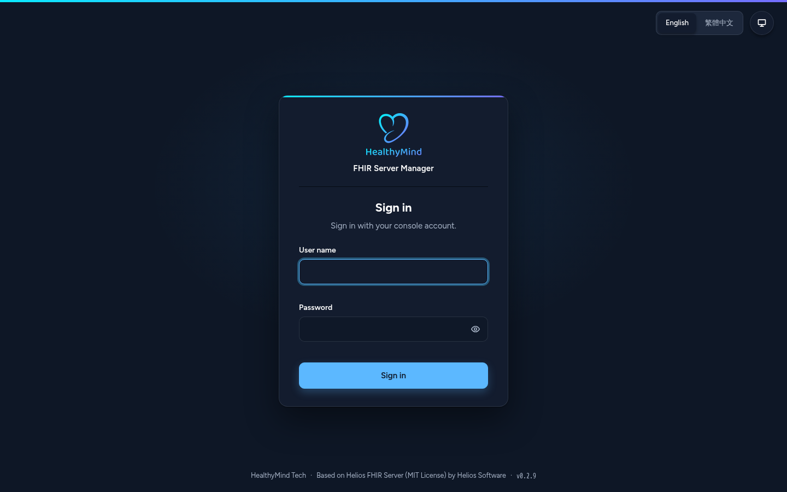 | 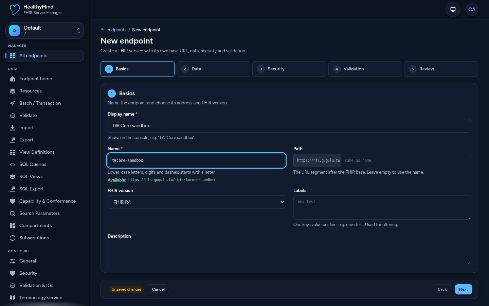 |
| **Console sign-in**: built-in accounts or single sign-on, with a break-glass administrator. | **New endpoint wizard**: name, base path, data, security and validation in five steps. |
| 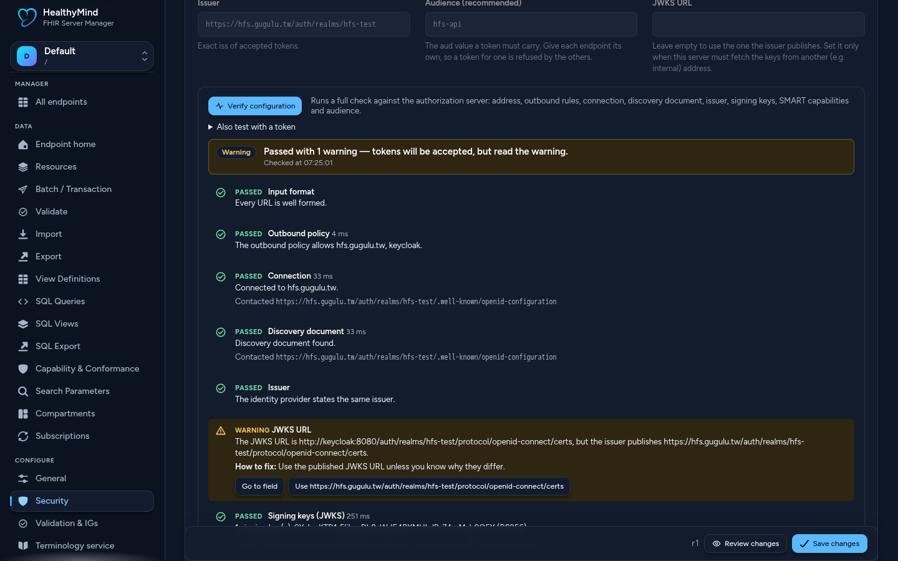 | 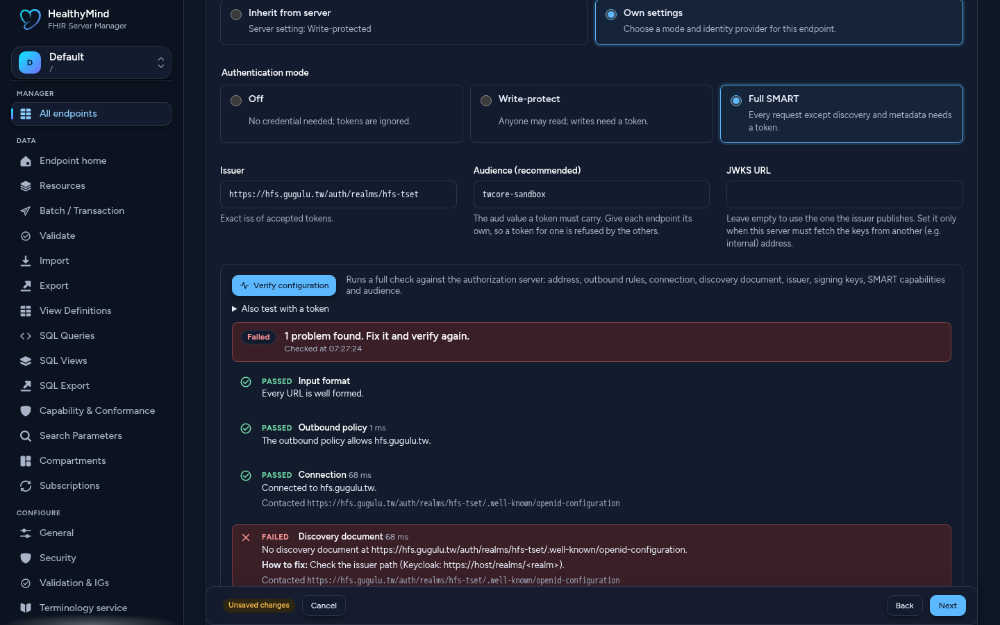 |
| **Verify on a live endpoint**: every step checked against the identity provider; a warning comes with the fix. | **Verify pinpoints the failure**: a mistyped issuer fails at the discovery document, with how to fix it. |
| 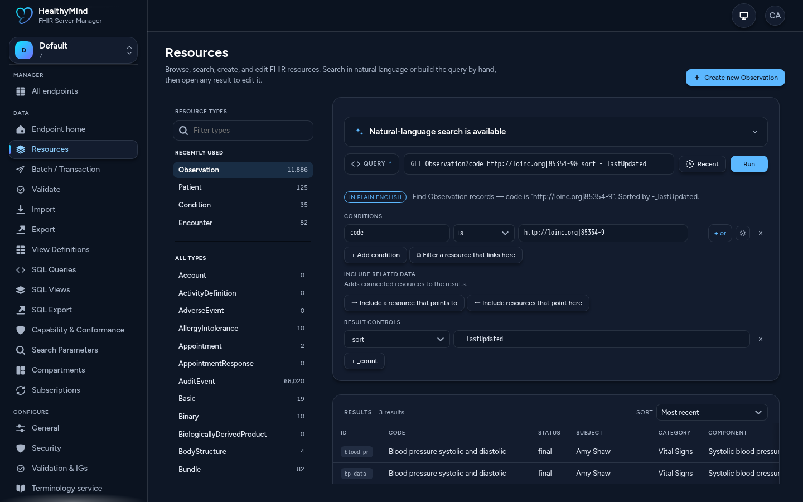 | 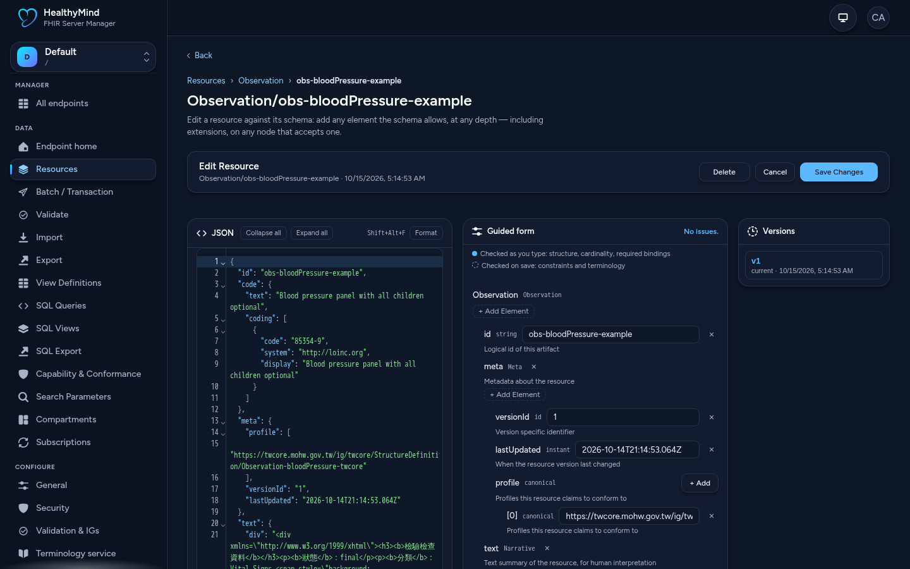 |
| **Resource browser**: build a search by hand or in plain language; the query and its meaning stay side by side. | **Resource editor**: JSON and a schema-driven form, checked as you type. |
| 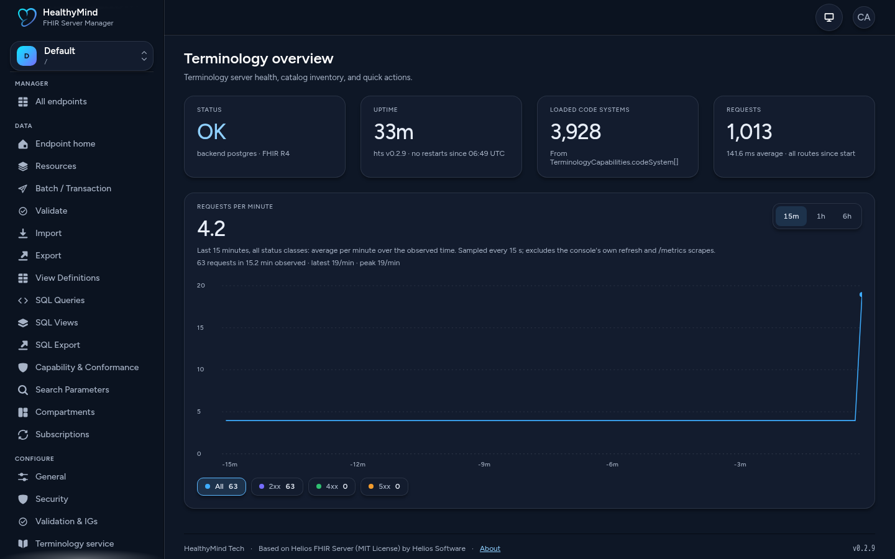 | 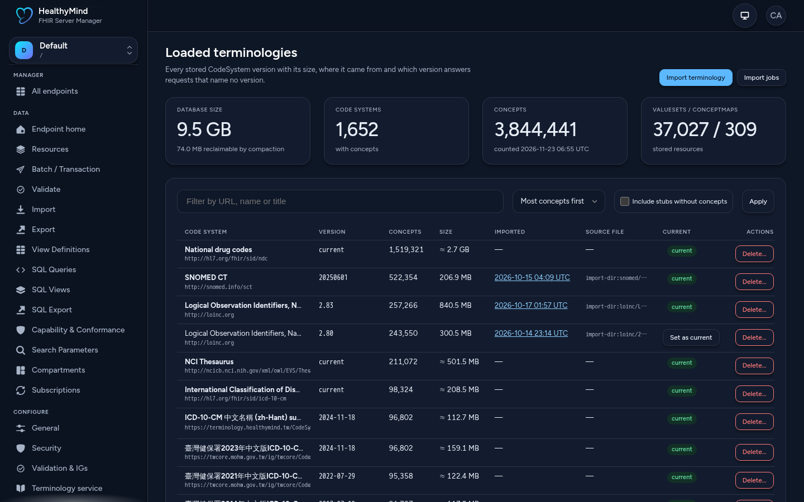 |
| **Terminology overview** at `/ui/terminology`, in the same console and session. | **Loaded terminologies**: 3.8M concepts by code system and version, with import jobs and the current version per system. |
| 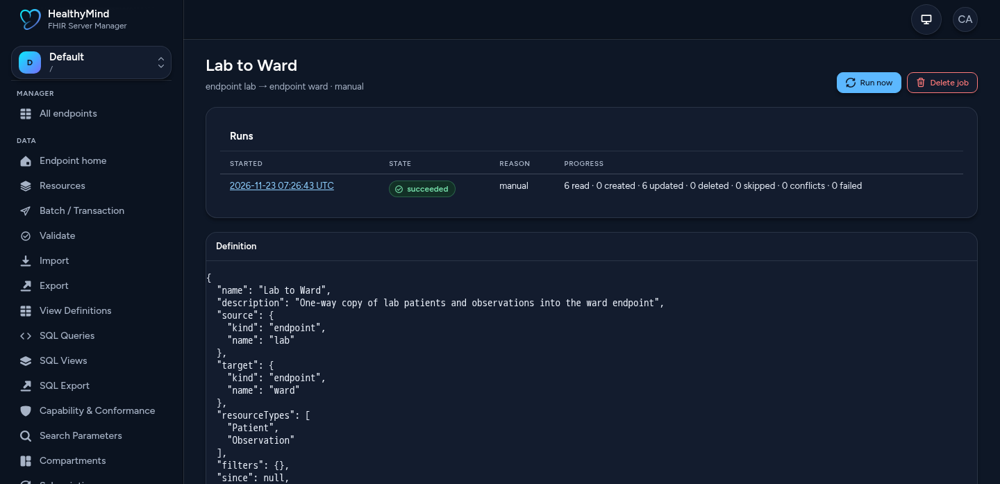 | 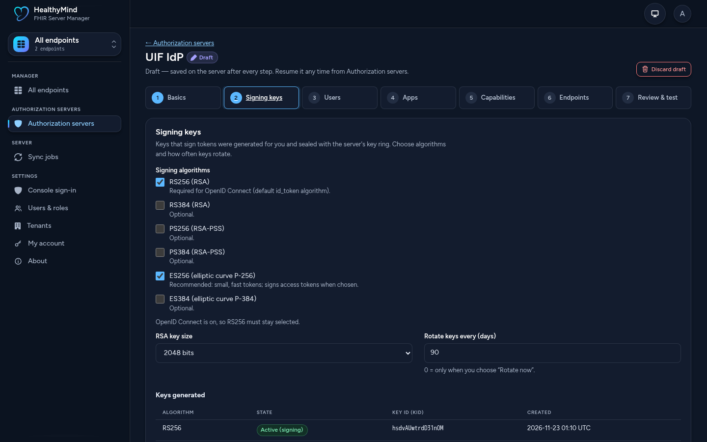 |
| **Sync job**: endpoint to endpoint, with run history and per-run counts. | **Authorization server wizard**: seven steps from realm to tested, bound endpoint. |
| 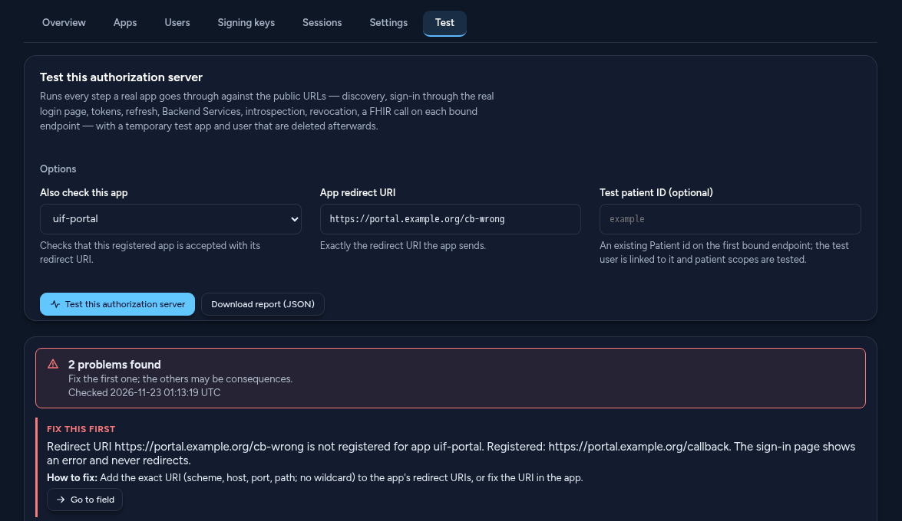 | 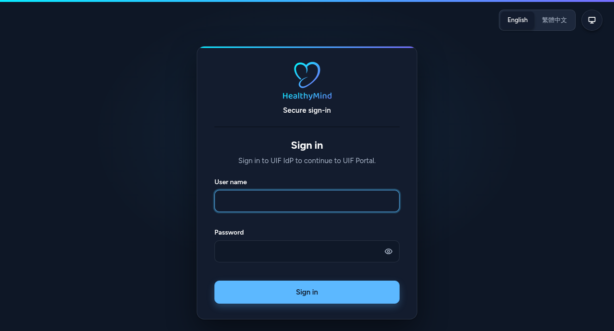 |
| **Authorization server test**: runs a real sign-in and names the first thing to fix. | **Hosted sign-in** of a realm, followed by patient picker and consent. |

## Architecture

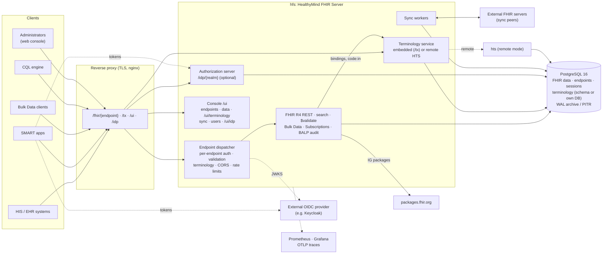

- **One PostgreSQL.** The terminology store is either its own database (remote
  `hts`, or embedded over the old database) or schema `terminology` inside the
  FHIR database. SQLite is supported for development and tests only.
- **Every terminology question goes through one service**: binding checks
  during validation, `code:in` searches, SQL on FHIR, FHIRPath and the
  terminology part of IG packages.
- **Horizontal scale**: run several `hfs` instances behind the proxy
  ([cluster.md](docs/ops/cluster.md)); endpoint changes, sessions, sync jobs
  and terminology cache invalidation are shared through the database.

## Quality, measured

Every number below names its test suite and what it counts. Where a target was
missed, we say so. Full reports are kept with the project's evaluation records.

### Terminology server: HL7 tx-ecosystem test suite

Official HL7 `fhir-tx-ecosystem-ig` tests, run with the HL7 `validator_cli`
test runner, on PostgreSQL and SQLite (identical results):

| Suite | Result |
|---|---|
| General | **697 / 697** |
| SNOMED CT | 72 / 72 |
| SNOMED CT ECL | 103 / 103 |
| UCUM | 19 / 19 (1 skipped) |
| closure | 10 / 10 |
| mimetypes | 39 / 39 |
| Runner total | **872 / 872** (5 skipped) |

Suites that need data we do not hold (OMOP, ICD-11) and tx.fhir.org-only
suites were not run.

### Embedded terminology and the single database

| Measurement | Result |
|---|---|
| Embedded vs. standalone terminology server, same requests | 1,253 cases: 1,089 byte-identical, 164 `$expand` differing only in identifier/timestamp, **0 differences** |
| Moving a production-sized terminology store (45M rows, 64 tables) into the FHIR database | verified row counts and checksums identical; 556 / 556 terminology answers identical before and after; **0 failed FHIR requests** of 2,576 during the move |
| Full LOINC import (257,266 concepts) under mixed FHIR load | FHIR p95 during import ÷ idle p95: 1.06–1.09 (limit 1.15) |

### SMART authorization

| Measurement | Result |
|---|---|
| Inferno SMART App Launch STU2.2, full server with the built-in authorization server | **86 pass, 0 fail, 2 omit** |
| Keycloak end-to-end, default endpoint / two realms × four endpoints | 77 / 77 · 41 / 41 |
| Authorization server browser end-to-end (sign-in, patient picker, consent, refresh, revocation, security checks) | 58 / 58 |
| Authorization server console journeys (wizard, diagnostic with injected faults, management) | 59 / 59 |

### Validator: HL7 `fhir-test-cases` (R4-applicable, 457 sub-tests)

The four classes of the old harness are split so that a "deviation" with the
wrong verdict counts as a failure:

| Class | Count |
|---|---|
| Strict pass (same error count and locations) | 325 |
| Pass on error count only (locations differ) | 55 |
| Deviation, right verdict, different count | 22 |
| **Deviation, wrong verdict (real failure)** | **32** (23 missed errors, 9 false positives) |
| Data unavailable (licensed or unavailable content: SNOMED national editions, HCPCS, X12, EDQM, NUCC, HGVS, VSAC) | 23 |

Reported the old way this is 380 pass / 54 deviation / 23 data-unavailable.
The 23 missed errors are features not implemented yet: terminology authoring
rules, R5 xhtml controls, Bundle signatures, `htmlChecks()` and a few smaller
rules.

### Validator: difference test against the HL7 Java validator

The same IG examples validated by our server and by the HL7 Java validator
(with tx.fhir.org). Set 9 = 590 examples (Taiwan IGs, US Core, IPS); set new =
729 examples from the other installed packages.

| Set | Agree on "has an error" | Precision | Recall | Same, excluding Java-side / licensed-terminology differences |
|---|---|---|---|---|
| 9 | 94.4 % | 98.1 % | 82.6 % | 100 % / 100 % / 96.5 % |
| new | 91.1 % | 89.2 % | 68.7 % | 98.5 % / 92.2 % / 86.9 % |

Precision = matched errors / errors we report; recall = matched errors / errors
the Java validator reports. Our targets were ≥ 97 % agreement and ≥ 85 %
recall on the raw numbers; **those raw targets are not met yet**. Most of the
gap is content we cannot load (SNOMED CT US Edition, CPT/HCPCS/X12, the HGVS
service), which is why the right-hand column is shown separately.

In `enforce` mode, 1,503 published examples from 37 packages (including all
seven Taiwan IGs) produced 143 rejections; every one was traced to the example
itself, a missing dependency, a version mismatch or a deliberate stricter
rule; **0 were validator bugs**. TW Core 1.0.0 and TW PAS examples: 0
rejections.

### Scale and performance (PostgreSQL on NVMe)

| Measurement | Result |
|---|---|
| 23 common search shapes on 2.64M resources (warm) | patient-scoped searches p95 4–21 ms; slowest shapes (code + date across all patients, chains over 2,000 targets, `$everything`) p95 119–224 ms |
| Load, Synthea transaction Bundles, 16 clients | 3.17M resources at 4,406 resources/s, 0 failed Bundles |
| Group `$export`, 14,000 patients (3.1M resources) | 243 s |
| `Patient/$everything`, 50 patients | p50 125 ms / p95 235 ms, complete, no duplicates |
| Restore drill (production-sized dump) | RTO about 1.5 min logical, about 1 min PITR; RPO ≤ 5 min with WAL archiving |
| Cluster: 3 HFS + 2 HTS, rolling restarts under load | 57 / 57 checks, 0 failed requests |
| CQL: 15 eCQMs, 273 test patients | 264 / 273 patients agree with the engine's reference run (HAPI FHIR 8.12 on the same data: 242 / 273) |

Rotating disks are not supported for the database: on an HDD, loads failed
with statement timeouts once the database passed about 9 GB.

### Release gates

Each production deployment is gated against the public URL by a 42-check
authentication suite, a 94-case validator regression, 112 terminology API
checks and 184 FHIR API checks (status codes identical to the previous
release), plus browser journeys through the console. The current production
release passed 42 / 42, 94 / 94, 112 / 112 and 184 / 184. In the last full
workspace run, the Rust test suite (default features) passed 10,666 tests
with 0 failures; the PostgreSQL persistence suite 3,821 / 0.

## Quick start

### Production: Docker Compose with PostgreSQL

`docker/production/` contains the production stack: PostgreSQL 16 with WAL
archiving, `hfs`, the terminology server, nginx, and optional monitoring
(Prometheus, Grafana, postgres-exporter) and tracing (OTLP collector, Jaeger)
profiles.

```bash
cd docker/production
cp .env.example .env && chmod 600 .env && $EDITOR .env   # image tags, secrets, public URL, storage paths
docker compose up -d db
docker compose up -d hts        # first boot imports the bundled terminology (~4 min)
docker compose up -d hfs nginx
curl -s -o /dev/null -w '%{http_code}\n' http://127.0.0.1:8082/fhir/metadata   # 200
```

To turn on the FHIR Server Manager, add to the `hfs` service's environment
(generate the key with `openssl rand -base64 32`):

```yaml
      HFS_MANAGER: "on"
      HFS_SECRET_KEYS: "k1:<base64 32-byte key>"   # seals console-entered secrets; keep it in a secret store
      HFS_CONSOLE_AUTH_MODE: local                 # or oidc, see docs/ops/console-sign-in.md
```

then `docker compose up -d hfs`, sign in at `https://<your host>/ui/login?local=1`
with the `ADMIN_PASSWORD` administrator and create the first admin account
under Settings → Users.

Images are built from this repository (release binaries with the production
feature set, packaged by the root `Dockerfile`) and pinned by tag; never deploy
`:latest`. The full procedure, sizing and TLS setup are in
[deployment.md](docs/ops/deployment.md); after first start, import SNOMED CT /
LOINC / ICD-10 ([terminology-updates.md](docs/ops/terminology-updates.md)),
install your IGs ([ig-update-sop.md](docs/ops/ig-update-sop.md)) and go
through the [go-live checklist](docs/ops/go-live-checklist.md).
Kubernetes manifests are in `docker/kubernetes/`.

### Run locally from source (SQLite, for evaluation)

Requires [Rust](https://www.rust-lang.org/tools/install) (1.95 or newer; the
toolchain is pinned in `rust-toolchain.toml`) and, on Linux, `clang` + `lld`
(see [Building from source](#building-from-source)).

```bash
git clone https://github.com/healthymind-tech/hfs.git
cd hfs
cargo build --release --locked -p helios-hfs

# FHIR server on :8080 with the embedded terminology service,
# seeded with the bundled terminology set (first start takes a few minutes)
HFS_TERMINOLOGY_BOOTSTRAP_DIR=./crates/hts/terminology-data \
HFS_ADMIN_UI=true HFS_ADMIN_PASSWORD="$(openssl rand -base64 24)" \
./target/release/hfs
```

Then open:

| URL | What |
|---|---|
| http://localhost:8080/ui | Console |
| http://localhost:8080/ui/terminology | Terminology console |
| http://localhost:8080/metadata | CapabilityStatement |
| http://localhost:8080/tx/metadata | Terminology CapabilityStatement |

```bash
# Create and search a resource
curl -s -X POST http://localhost:8080/Patient \
  -H 'Content-Type: application/fhir+json' \
  -d '{"resourceType":"Patient","name":[{"family":"Chen","given":["Ming"]}]}'
curl -s 'http://localhost:8080/Patient?family=Chen'

# Validate without storing
curl -s -X POST http://localhost:8080/Patient/\$validate \
  -H 'Content-Type: application/fhir+json' \
  -d '{"resourceType":"Patient","gender":"unknown-value"}'
```

Endpoints created from the console are stored in PostgreSQL; on SQLite,
additional endpoints are declared with `HFS_ENDPOINTS_FILE`
([endpoints.md](docs/ops/endpoints.md)).

### Building from source

1. Install Rust: `curl --proto '=https' --tlsv1.2 -sSf https://sh.rustup.rs | sh`
2. Linux: `sudo apt install clang lld`, then in `~/.cargo/config.toml`:
   ```toml
   [target.x86_64-unknown-linux-gnu]
   linker = "clang"
   rustflags = ["-C", "link-arg=-fuse-ld=lld", "-C", "link-arg=-Wl,-zstack-size=8388608"]
   ```
   macOS needs no extra linker; on Windows use `lld-link.exe` with
   `rustflags = ["-C", "link-arg=/STACK:8388608"]`.
3. Build with the production feature set:
   ```bash
   cargo build --release --locked -p helios-hfs -p helios-hts --features \
     helios-hfs/R4,helios-hfs/sqlite,helios-hfs/postgres,helios-hfs/ui,helios-hfs/xml,helios-hfs/subscriptions,helios-hfs/bulk-submit-jwe,helios-hfs/mimalloc,helios-hfs/otel,helios-hts/postgres,helios-hts/otel
   ```
   If the build runs out of memory, limit parallel jobs: `export CARGO_BUILD_JOBS=4`.
4. Run the tests: `cargo test --workspace` (add `--all-features` for the CI
   selection; PostgreSQL integration tests use Docker testcontainers).

## Configuration quick reference

All settings are environment variables. Settings that the console can edit
(endpoints, console sign-in, authorization-server realms) are stored in the
database; an environment variable that names one of them **pins** it.

### Storage and public URL

| Variable | Typical value | Purpose |
|---|---|---|
| `HFS_STORAGE_BACKEND` / `HFS_DATABASE_URL` | `postgres` / `postgres://hfs:…@db:5432/hfs` | FHIR data store |
| `HFS_BASE_URL` | `https://fhir.hospital.example/fhir` | Public base URL; endpoint paths are appended to it |
| `HFS_PG_MAX_CONNECTIONS` / `HFS_PG_STATEMENT_TIMEOUT_MS` | `64` / `60000` | Pool and statement timeout |
| `HFS_CLUSTER` | `true` | Several instances on one database |

### FHIR Server Manager and console

| Variable | Default | Purpose |
|---|---|---|
| `HFS_MANAGER` | `off` | `on` enables multiple endpoints, per-endpoint settings, sync and the manager console |
| `HFS_ENDPOINTS_FILE` | — | JSON list of endpoints applied at start-up (read-only in the console) |
| `HFS_SECRET_KEYS` / `HFS_SECRET_KEYS_FILE` | — | Key ring `id:base64key[,…]` (32-byte keys, first one active) sealing console-entered secrets; required by the authorization server |
| `HFS_OUTBOUND_ALLOW` | — | Hosts, `*.suffix` or CIDRs that console-entered URLs may reach besides public `https` (internal IdPs, sync peers) |
| `HFS_CONSOLE_AUTH_MODE` | `none` | `none`, `local` or `oidc` |
| `HFS_CONSOLE_OIDC_ISSUER` / `_CLIENT_ID` / `_CLIENT_SECRET(_FILE)` / `_ROLE_CLAIM` / `_ADMIN_VALUES` | — | OIDC console sign-in and role mapping ([console-sign-in.md](docs/ops/console-sign-in.md)) |
| `HFS_ADMIN_UI` / `HFS_ADMIN_PASSWORD(_FILE)` | `true` / secret | Admin pages and the break-glass administrator (fail closed without a password) |
| `HFS_SYNC_ENABLED` / `HFS_SYNC_WORKERS` / `HFS_SYNC_EXTERNAL` | `true` / `2` / `true` | Sync workers on this instance; allow external peers ([sync.md](docs/ops/sync.md)) |

### Terminology

| Variable | Default | Purpose |
|---|---|---|
| `HFS_TERMINOLOGY` | `embedded` (or `remote` when `HFS_TERMINOLOGY_SERVER` is set) | `embedded`, `remote` or `off` |
| `HFS_TERMINOLOGY_SERVER` / `HFS_TERMINOLOGY_SERVER_TOKEN` | — | Remote terminology server and its admin credential |
| `HFS_TERMINOLOGY_DATABASE_URL` | derived from the FHIR store | Embedded store location (schema `terminology`, or `terminology.db` next to the SQLite file) |
| `HFS_TERMINOLOGY_BOOTSTRAP_DIR` | — | Terminology seed imported at start-up |
| `HFS_TERMINOLOGY_READONLY` | `false` | Freeze terminology writes (`503`) during maintenance |

The old `HTS_*` names are still read for the embedded service and logged once
as deprecated. Import pacing knobs are in
[unified-server.md](docs/ops/unified-server.md#4a-terminology-imports-next-to-fhir-traffic-u3).

### Authentication and authorization

| Variable | Typical value | Purpose |
|---|---|---|
| `HFS_AUTH_MODE` | `write-protect` or `full` | Server-wide SMART on FHIR / OIDC enforcement (endpoints may override) |
| `HFS_AUTH_ISSUER` / `HFS_AUTH_JWKS_URL` / `HFS_AUTH_AUDIENCE` | your IdP | Token validation |
| `HFS_RATE_LIMIT_ANONYMOUS` / `HFS_RATE_LIMIT_AUTHENTICATED` | `600` / `6000` per minute | Per-client rate limits |
| `HFS_IDP` | `off` | `on` mounts the built-in authorization server at `/idp/{realm}` |
| `HFS_IDP_PUBLIC_BASE` | origin of `HFS_BASE_URL` | Public origin used in realm issuers |

### Validation

| Variable | Typical value | Purpose |
|---|---|---|
| `HFS_VALIDATION_MODE` | `off` → `log` → `enforce` | Validate on write; start with `log` and review |
| `HFS_VALIDATION_TERMINOLOGY` | `embedded`, `remote` or `off` | Required-binding checks offline (core value sets) or by the terminology server |
| `HFS_VALIDATION_STORED_PROFILES` | `true` | Validate against StructureDefinitions stored on the server |

### Audit and observability

| Variable | Typical value | Purpose |
|---|---|---|
| `HFS_AUDIT_BACKEND` | `database` | IHE BALP audit trail |
| `HFS_AUDIT_RETENTION_DAYS` | e.g. `2557` (7 years) | Audit retention, with archive before purge |
| `HFS_BULK_EXPORT_BATCH_SIZE` | `5000` | Bulk export throughput |
| `OTEL_EXPORTER_OTLP_ENDPOINT` | `http://otel-collector:4317` | Traces (image built with `otel`) |

Detailed references: [endpoints.md](docs/ops/endpoints.md),
[console-sign-in.md](docs/ops/console-sign-in.md), [sync.md](docs/ops/sync.md),
[idp.md](docs/ops/idp.md), [unified-server.md](docs/ops/unified-server.md),
[postgresql.md](docs/ops/postgresql.md), [auth.md](docs/ops/auth.md),
[audit.md](docs/ops/audit.md), [cluster.md](docs/ops/cluster.md),
[monitoring.md](docs/ops/monitoring.md). The upstream documentation book in
`book/` covers the remaining variables.

## Deployment and operations

The [operations manual](docs/ops/README.md) is written for hospital IT and has
been rehearsed on production-sized data:

| Page | For |
|---|---|
| [go-live-checklist.md](docs/ops/go-live-checklist.md) | everything that must be true before cut-over |
| [deployment.md](docs/ops/deployment.md) | Docker Compose and Kubernetes, sizing, TLS |
| [endpoints.md](docs/ops/endpoints.md) | the FHIR Server Manager: endpoints, URLs, per-endpoint settings, rollback |
| [console-sign-in.md](docs/ops/console-sign-in.md) | console sign-in modes, users, roles, sessions, CSRF |
| [sync.md](docs/ops/sync.md) | sync jobs and endpoint duplication |
| [idp.md](docs/ops/idp.md) | the built-in authorization server: switch, hosted pages, lockout, audit, nginx |
| [unified-server.md](docs/ops/unified-server.md) | embedded terminology, moving the terminology store into the FHIR database, rollback |
| [postgresql.md](docs/ops/postgresql.md) | server parameters, pools, timeouts, roles, maintenance |
| [database-migrations.md](docs/ops/database-migrations.md) | schema versions and how migrations are applied |
| [backup-restore.md](docs/ops/backup-restore.md) | logical dumps, WAL archiving, PITR, drill timings, RPO/RTO |
| [monitoring.md](docs/ops/monitoring.md) | Prometheus, Grafana, alerts, OTLP traces, alert runbook |
| [upgrade.md](docs/ops/upgrade.md) | image upgrades, verification, rollback |
| [index-strategy.md](docs/ops/index-strategy.md) | search index review and EXPLAIN results |
| [auth.md](docs/ops/auth.md) / [admin-sign-in.md](docs/ops/admin-sign-in.md) | SMART on FHIR / OIDC rollout, administrator sign-in |
| [audit.md](docs/ops/audit.md) | audit trail, retention, archive |
| [cluster.md](docs/ops/cluster.md) | multi-instance topology and rolling restarts |
| [cql.md](docs/ops/cql.md) | connecting a CQL engine |
| [ig-packages.md](docs/ops/ig-packages.md) / [ig-update-sop.md](docs/ops/ig-update-sop.md) | the package installer and the IG change procedure |
| [terminology-updates.md](docs/ops/terminology-updates.md) / [terminology-release-calendar.md](docs/ops/terminology-release-calendar.md) | terminology imports and the yearly update calendar |
| [upstream-rebase.md](docs/ops/upstream-rebase.md) | bringing in upstream Helios releases |

Operational scripts (backup, restore, base backup, PITR restore, WAL pruning,
the terminology database move, search benchmark, ValueSet warm-up) are in
`scripts/ops/`. Admin API references: [admin-endpoints.yaml](docs/api/admin-endpoints.yaml),
[admin-terminology.yaml](docs/api/admin-terminology.yaml),
[admin-idp.json](crates/idp-admin/openapi/admin-idp.json).

## Roadmap

- **Authorization server**: external penetration test before production
  patient data, MFA (TOTP, then WebAuthn), upstream OpenID Connect and console
  accounts as identity sources, an EHR launcher in the console, persisted
  diagnostic history.
- **Single database in production**: move the terminology store into the FHIR
  database once the host has the disk headroom the move needs.
- **Validator**: Bundle signature verification, HL7-namespace URI resolution,
  `htmlChecks()`, faster stored document Bundles under `enforce`, and higher
  recall against the HL7 Java validator.
- **Upstream**: continue merging Helios FHIR Server releases (currently
  merged through v0.2.9).

## Support and contact

HealthyMind FHIR Server is developed and supported by **療心智能
HealthyMind.Tech**. For deployment, support or partnership enquiries, contact
HealthyMind Tech through the
[healthymind-tech GitHub organization](https://github.com/healthymind-tech).
Bug reports and feature requests are welcome as
[GitHub issues](https://github.com/healthymind-tech/hfs/issues).

Please do not post patient data, credentials or other confidential
information in issues.

## Acknowledgements and license

HealthyMind FHIR Server is a fork of, and is built on, the open-source
**[Helios FHIR Server](https://github.com/HeliosSoftware/hfs)** by
**Helios Software**, released under the MIT License. The FHIR data models,
FHIRPath engine, SQL on FHIR, persistence layer, REST layer, terminology
server foundations and much more come from that project and its contributors;
we are grateful for their work. HealthyMind Tech's changes are focused on
hospital production use: the FHIR Server Manager, the unified console, the
built-in authorization server, validation and terminology completeness, Taiwan
IG support, SMART on FHIR enforcement, audit, PostgreSQL operations,
clustering and Bulk Data performance. We contribute fixes upstream where they
apply.

HealthyMind FHIR Server is an independent product of HealthyMind Tech. It is
not affiliated with or endorsed by Helios Software. "Helios" and related names
and logos belong to their respective owners.

This project is distributed under the **MIT License**; see
[LICENSE.md](LICENSE.md). The original copyright notice
("Copyright 2025-2026 Helios Software") and permission notice are retained, as
the license requires. Upstream contribution guidelines are in
[CONTRIBUTING.md](CONTRIBUTING.md).

Third-party terminologies are licensed separately. The bundled seed set in
`crates/hts/terminology-data` contains only freely distributable content (HL7
terminology and core packages, ICD-10-CM, ICD-9-CM, NDC, NUCC, MeSH, NCI
Thesaurus, UCUM; see its README). SNOMED CT, LOINC and the Taiwan MOHW/NHI
code tables are **not** distributed with this software; obtain them from their
publishers under their own terms (for example, SNOMED CT requires an Affiliate
Licence or national membership).

FHIR® is the registered trademark of Health Level Seven International (HL7);
its use here does not constitute endorsement by HL7.
